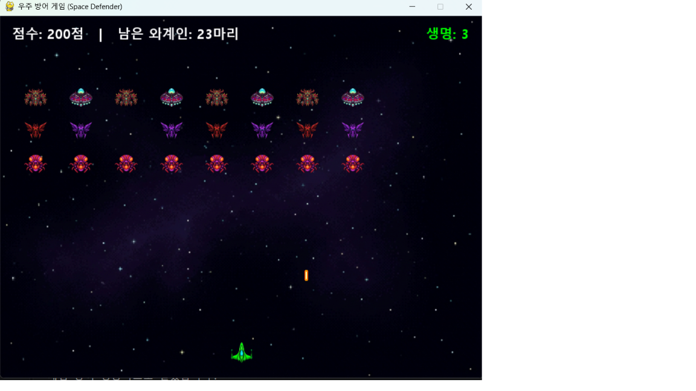
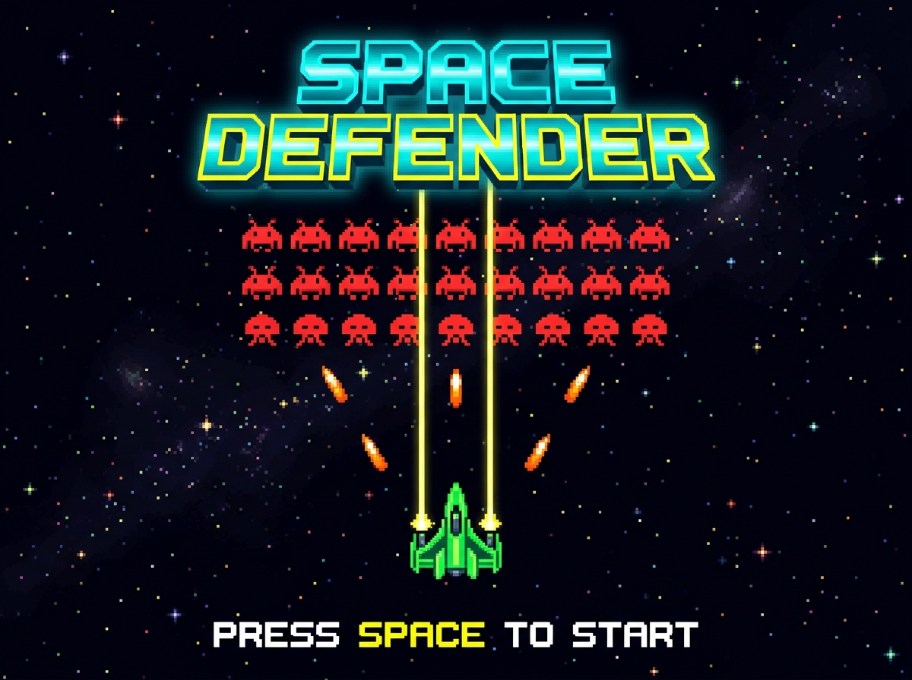

# 🚀 우주 방어 게임 (Space Defender)

Python의 `pygame` 라이브러리를 활용하여 제작한 **16비트 레트로 아케이드 스타일 우주 슈팅 게임(Wave Defense)**입니다.  
고전 오락실 명작(*갤러그*, *스페이스 인베이더*)의 감성을 현대적인 네온 픽셀 아트와 8비트 신디사이저 효과음, 명예의 전당 랭킹 시스템으로 재해석했습니다.

---

## 🎮 게임 화면 (Screenshots)

### 1. 인게임 플레이 화면


### 2. 인트로 타이틀 화면


---

## ✨ 주요 기능 및 특징

* **👾 3×8 외계인 군단 (총 5종 픽셀 아트 기체):**
  * **1열 (지휘부):** 대장 외계인(`enemy_row1.png`) & 외계 UFO 모선(`enemy_ufo.png`) — 격추 시 **300점**
  * **2열 (주력부):** 전투 외계인(`enemy.png`) & 네온 퍼플 중장갑 외계인(`enemy_heavy.png`) — 격추 시 **200점**
  * **3열 (정찰부):** 정찰 외계인(`enemy_row3.png`) — 격추 시 **100점**
  * 화면 양 끝에 닿으면 군단 전체가 한 칸씩 하강하며 이동 방향을 반대로 전환합니다.
* **💚 생명(3개) 및 일시 무적 시스템:**
  * 화면 우측 상단에 남은 생명(`생명: 3`)이 숫자와 색상(초록 → 노랑 → 빨강)으로 표시됩니다.
  * 적 탄환에 피격되면 생명이 1씩 차감되며, **1.2초간 일시 무적(기체 점멸)** 상태가 부여되어 연속 피격을 방지합니다.
  * 승리 시 남은 생명 1개당 **+500점**의 보너스 점수가 추가됩니다.
* **💥 다단계 도트 폭발 애니메이션 & 8비트 사운드:**
  * 적 격추 및 피격 시 **초기 섬광 → 충격파 링 및 14개 불꽃 파편 확산 → 페이드 아웃**의 3단계 폭발 애니메이션이 재생됩니다.
  * 외부 음원 의존성 없이 파이썬 표준 라이브러리로 합성한 6종의 8비트 아케이드 효과음(`shoot.wav`, `explosion.wav`, `victory.wav` 등)이 자동 재생됩니다.
* **🏆 알파벳 3글자 이니셜 입력 & 영구 랭킹 보드 (`TOP 5`):**
  * 게임 종료 후 오락실 스타일로 **알파벳 3글자(`A`~`Z`) 이니셜**을 입력하여 점수를 등록할 수 있습니다.
  * 기록은 `rankings.json`에 영구 저장되어 게임을 종료했다가 다시 실행해도 그대로 유지됩니다.

---

## 🕹️ 조작 방법 (Controls)

| 키보드 입력 | 동작 설명 |
| :---: | :--- |
| **`Space` / `Enter`** | 인트로 화면에서 게임 시작 |
| **`←` `→` 또는 `A` `D`** | 플레이어 우주선 좌우 이동 |
| **`Space` (스페이스바)** | 레이저 미사일 발사 (0.4초 쿨타임 적용) |
| **`A` ~ `Z` / `Backspace` / `Enter`** | 게임 종료 후 랭킹용 알파벳 3글자 이니셜 입력 및 등록 |
| **`R`** | 랭킹 등록 후 게임 다시 시작 |
| **`ESC`** | 게임 즉시 종료 |

---

## 📂 프로젝트 폴더 구조

```text
retro_game/
├── SpaceDefender.exe       # [단독 실행 파일] 파이썬 설치 없이 바로 실행 가능한 배포용 EXE
├── main.py                 # [메인 실행] 게임 루프, 3x8 군단 이동, 충돌 판정, HUD 및 랭킹 화면
├── sprites.py              # [오브젝트] 플레이어, 5종 외계인, 레이저 탄환, 다단계 폭발 애니메이션
├── settings.py             # [환경 설정] 해상도(800x600), 속도, 쿨타임, 생명, 점수 설정값 관리
├── sounds.py               # [사운드] 8비트 레트로 효과음(WAV) 자동 합성 및 재생 모듈
├── ranking.py              # [랭킹 관리] 알파벳 3글자 이니셜 및 점수 영구 저장(rankings.json)
├── space_defender_mvp.md   # [기획서] 우주 방어 게임 초기 MVP 기획 문서
└── assets/                 # [리소스 폴더]
    ├── player/             # 플레이어 기체, 아군 레이저, 폭발 이펙트 PNG
    ├── enemy/              # 외계인 적군 5종 및 적 에너지 탄환 PNG
    ├── background/         # 인트로 화면, 심우주 배경, VICTORY / GAME OVER 배너
    └── sounds/             # 8비트 레트로 아케이드 효과음 WAV 6종
```

---

## ▶️ 실행 방법

### 방법 1. 배포용 실행 파일(`EXE`)로 바로 실행 (파이썬 불필요)
프로젝트 폴더 내의 **`SpaceDefender.exe`** 파일을 더블클릭하면 즉시 게임이 실행됩니다.

### 방법 2. 파이썬 소스 코드로 실행
```bash
# 1. 필수 라이브러리 설치 (Python 3.14 환경의 경우 pygame-ce 권장)
pip install pygame-ce

# 2. 게임 실행
python main.py
```
